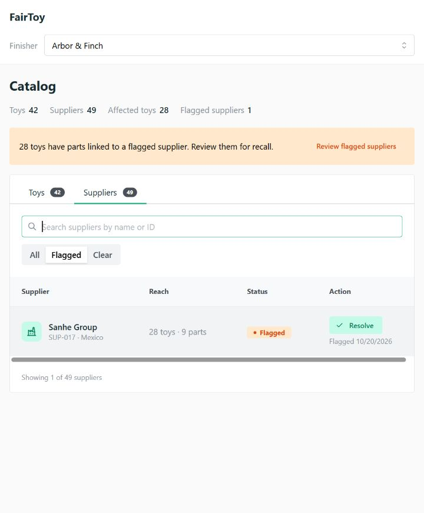
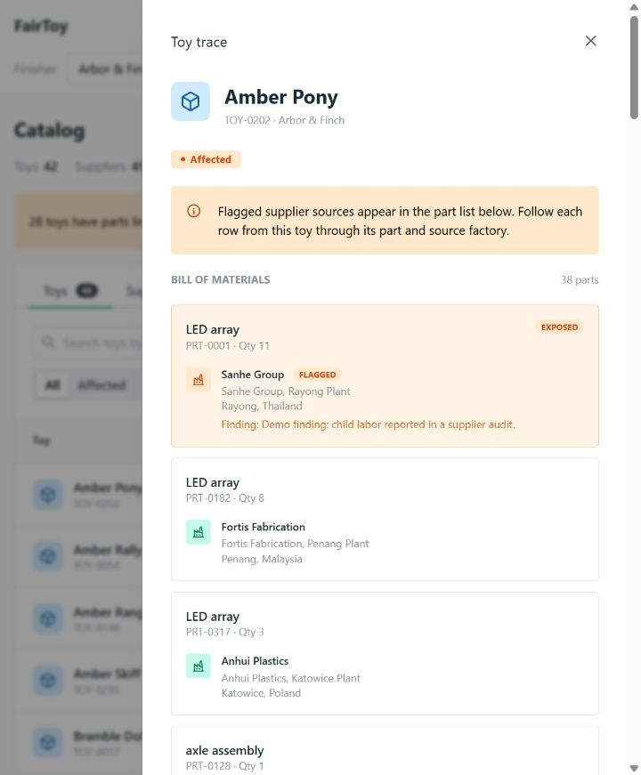
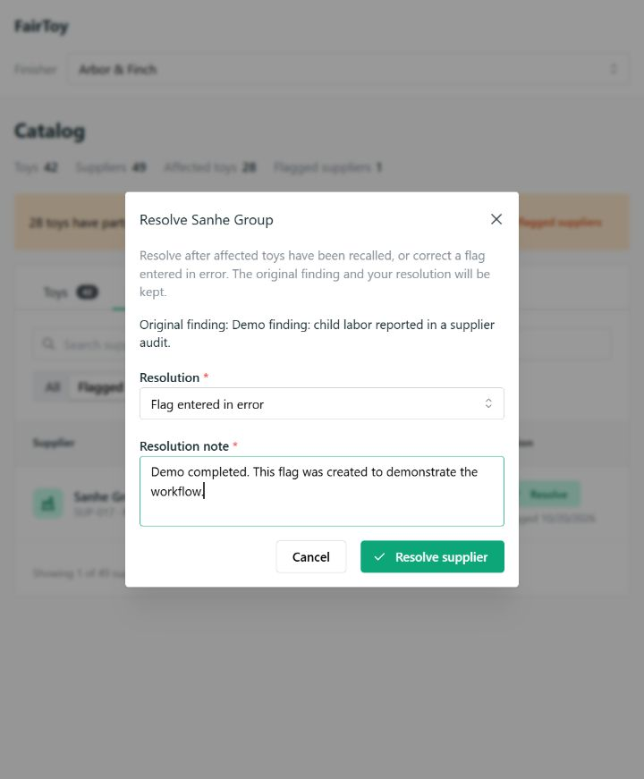

# FairToy

View toys and their parts, flag suppliers for child labor, and see which toys are affected. Flags can be resolved with a note.

React frontend, FastAPI backend, SQLite database.

## Run with Docker

Requires Docker with Compose. From the repository root:

```sh
docker compose up --build -d --wait
```

Open [localhost:8080](http://localhost:8080). API docs are at [localhost:8080/docs](http://localhost:8080/docs).

CSV data loads automatically. Flags and resolutions are saved between restarts.
Databases created with the older `part_source.supplier_id` schema are not migrated automatically. Back up any data you need before starting with a fresh database; `create_all()` does not update existing tables.

Stop with `docker compose down`. Add `--volumes` to delete the database and start fresh.

## Run without Docker

Requires Python 3.12+ and Node 22.12+.

Create a virtual environment with `python -m venv .venv`. Activate it with `.venv\Scripts\Activate.ps1` on Windows or `source .venv/bin/activate` on macOS/Linux.

Backend, from the repository root:

```sh
python -m pip install -r requirements.txt
python -m backend.server
```

Frontend, in another terminal:

```sh
cd frontend
npm ci
npm run dev
```

Open the URL printed by Vite, normally [localhost:5173](http://localhost:5173).

## Tests

With the virtual environment active:

```sh
python -m pip install -r requirements-dev.txt
python -m unittest discover -s tests -v
```

Frontend checks: `npm run build` and `npm run format:check` from `frontend/`.

## Data assumptions

Flags belong to individual finishers. A toy is potentially affected if any source for one of its parts is flagged; the CSVs do not identify the source used in each batch. Resolving a flag keeps its history and records the user's confirmation, rather than executing a recall.

## Screenshots






